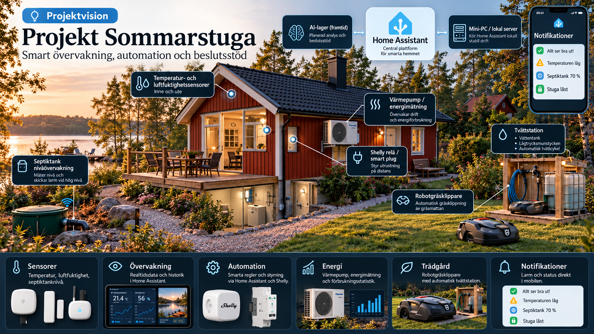

# summerhouse-iot
IoT and embedded systems portfolio project for monitoring, automation and data-driven control of a summer house.

# 🏡 Summer House IoT

<p align="center">
  
</p>

A long-term **Embedded Systems & IoT portfolio project** where an existing summer house is gradually upgraded with local monitoring, automation and data-driven control.

The project is being developed alongside my studies in **Embedded Systems & IoT at Nackademin** and gives me the opportunity to apply software development, embedded systems, sensors, communication protocols and system integration to a real environment.

---

## 🎯 Project Vision

The goal is to build a modular IoT platform that can monitor and control important systems in the property while collecting useful data for analysis and future optimisation.

The project focuses on:

- Local-first automation
- Energy monitoring
- Heating optimisation
- Environmental sensing
- Remote monitoring
- Wireless IoT sensors
- Historical data
- Notifications and alarms
- Embedded development
- Reliable and maintainable system design

Existing equipment is reused wherever practical instead of replacing functioning hardware.

---

## 🔥 Current Focus – Heating System

The first major development phase focuses on understanding and improving the existing hydronic heating system.

The system will provide:

- Room-level temperature monitoring
- Smart radiator control
- Heating system temperature measurements
- Energy monitoring
- Historical data
- Remote system status
- Different operating modes
- Sensor and battery health monitoring

The first objective is to **collect reliable real-world data and understand how the heating system behaves** before introducing more advanced optimisation.

---

## 🖥️ Local IoT Platform

A dedicated local platform will act as the central system for the property.

The architecture is built around:

- Home Assistant
- Local network integrations
- Sensor telemetry
- Historical data
- Automation
- Dashboards
- Secure remote access

The goal is to keep as much functionality as possible available locally rather than making critical property functions dependent on cloud services.

---

## 📡 IoT & Wireless Monitoring

The platform is designed to support several different communication technologies depending on the application.

Technologies being used or evaluated include:

- Wi-Fi
- Bluetooth Low Energy
- Zigbee
- MQTT
- LoRaWAN

This allows short-range indoor devices and long-range outdoor sensors to become part of the same overall platform.

---

## 🛢️ Future Property Monitoring

Later development phases will add additional monitoring around the property.

Planned areas include:

- Utility level monitoring
- Long-range outdoor sensors
- Property status monitoring
- Door and window monitoring
- Local and mobile alerts
- Environmental data
- Additional embedded IoT nodes

Each subsystem will be developed and tested independently before being integrated into the complete system.

---

## 🔔 Notifications & Local Alerts

Home Assistant will eventually combine information from multiple systems and provide relevant notifications.

Possible notification channels include:

- Mobile notifications
- Local dashboards
- Voice announcements
- Physical status indicators

The goal is to make important information easy to understand without requiring constant manual monitoring.

---

## 🧠 Data Analysis

One of the long-term goals is to use historical sensor data to better understand how the property behaves.

Areas that may be analysed include:

- Heating performance
- Energy usage
- Room temperature behaviour
- Environmental conditions
- Sensor trends
- System anomalies
- Long-term changes

AI-based analysis may later be introduced as **decision support**, while critical control and safety functions remain deterministic and independent.

---

## 🛠️ Technologies

Technologies used or evaluated during the project include:

- Home Assistant
- ESP32
- C / C++
- Shelly
- MQTT
- LoRaWAN
- Zigbee
- Bluetooth LE
- Sensor telemetry
- Local networking
- Secure remote access
- Python
- Git
- GitHub

Additional technologies will be introduced as the project develops.

---

## 🧪 Development Process

The project follows a structured engineering workflow:

```text
Requirements
    ↓
Planning
    ↓
Architecture
    ↓
Component selection
    ↓
Prototype / Bench testing
    ↓
Installation
    ↓
Verification
    ↓
Data collection
    ↓
Analysis
    ↓
Documentation
```

A major principle throughout the project is to make modifications **reversible wherever practical** and to keep existing safety functions intact.

---

## ♻️ Reuse Before Replacement

An important part of the project is working with an existing property rather than designing everything from scratch.

Where practical, existing hardware and infrastructure are reused and integrated into the new platform.

This makes the project a realistic exercise in:

- System integration
- Compatibility
- Legacy equipment
- Cost-aware engineering
- Troubleshooting
- Incremental development

---

## 📊 Project Status

### Phase 1 – Local platform & heating

🟡 **In development**

Focus:

- Local IoT platform
- Heating monitoring
- Room-level control
- Energy data
- Sensor integration
- Data collection

### Phase 2 – Additional property monitoring

🟡 **Planned**

Additional wireless monitoring and property automation will be integrated into the same platform.

### Portfolio milestone

🎯 **September 2027**

The goal is to have a stable and documented core system ready to demonstrate during industry networking and upcoming internship applications.

---

## 🎓 Portfolio Purpose

This project is also being developed as part of my technical portfolio.

It gives me practical experience in:

- Embedded systems
- IoT architecture
- Software development
- Sensors and actuators
- Communication protocols
- Hardware/software integration
- Networking
- Automation
- Data collection
- Fault handling
- Testing
- Technical documentation

Rather than being a single prototype, the objective is to build and maintain a **complete IoT system that evolves over time**.

---

## 🚀 Future Development

Possible later extensions include:

- Additional long-range sensors
- Embedded low-power nodes
- Property alarm functionality
- Advanced heating optimisation
- Environmental monitoring
- Automated maintenance systems
- Energy analysis
- Predictive monitoring

The modular architecture allows each new subsystem to be developed independently.

---

## 📷 Project Documentation

As development progresses, this repository will be updated with selected:

- Architecture diagrams
- Project photos
- Development milestones
- Dashboard screenshots
- Test results
- Lessons learned

Detailed implementation information is intentionally kept separate from the public repository.

---

## 👤 Author

**Fredrik Engberg**

Embedded Systems & IoT Student  
Nackademin

[GitHub Profile](https://github.com/FredrikEngberg)

---

## 🔒 Public Repository Notice

This is the **public portfolio version** of the project.

The repository intentionally does **not** contain complete implementation details.

Information such as the following is kept in private development documentation:

- Detailed wiring diagrams
- Reverse-engineering results
- Complete control logic
- Device-specific configuration
- Full automation configuration
- Network architecture
- Credentials and secrets
- Property-identifying information

The purpose of this repository is to document the project's **development, engineering approach and results** without publishing security-sensitive or proprietary implementation details.
